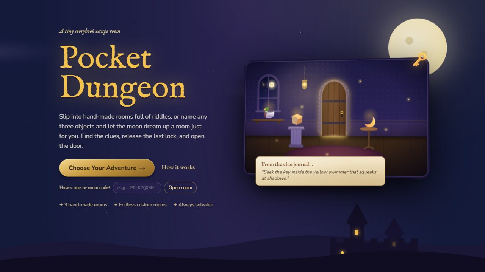
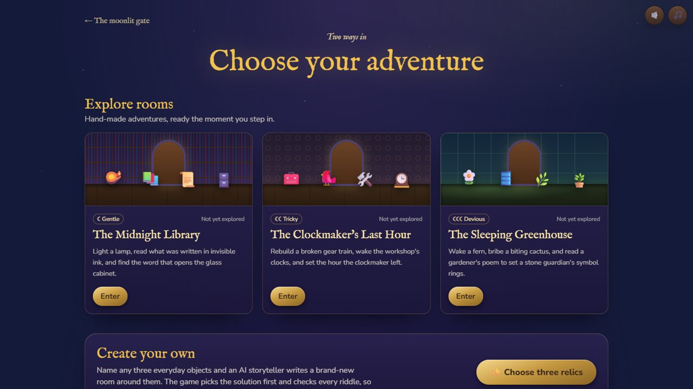
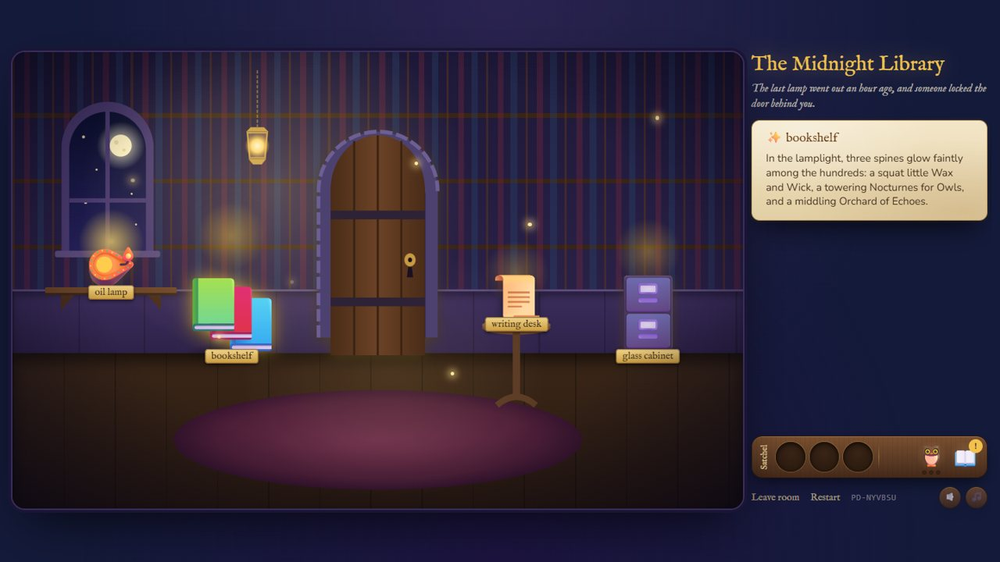
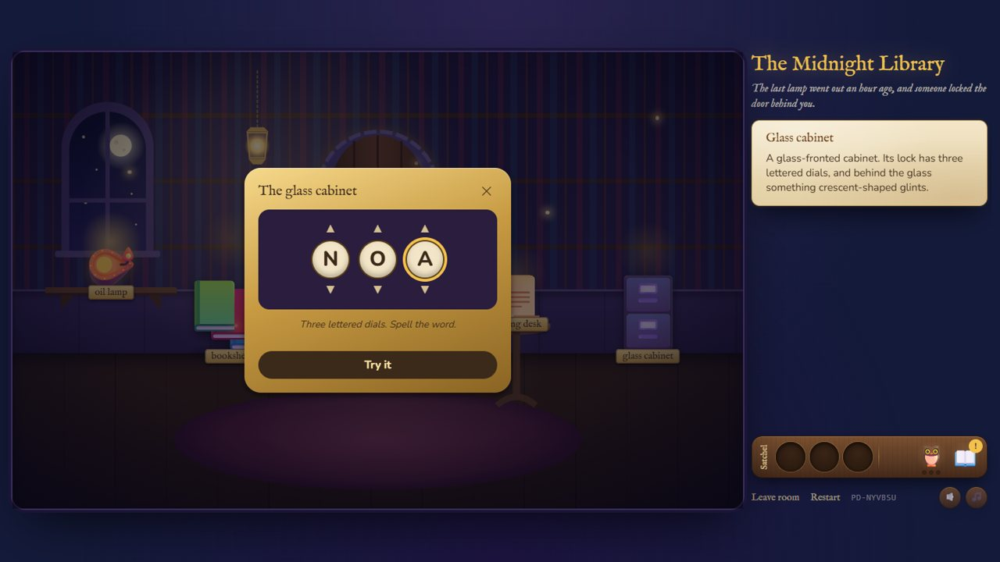
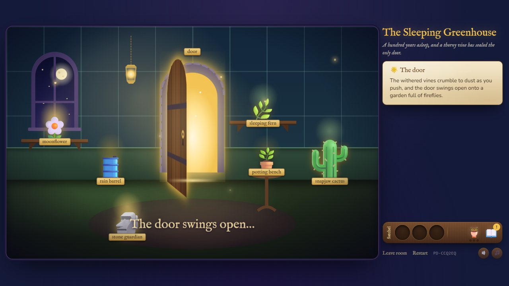
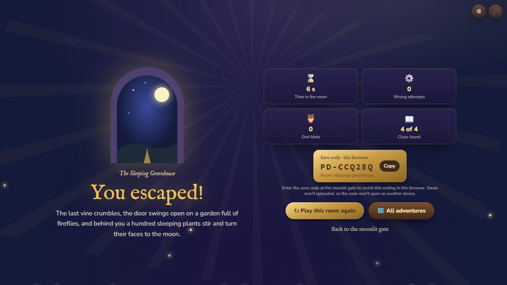

<div align="center">

# 🌙 Pocket Dungeon

**A tiny storybook escape room.**
Slip into hand-made rooms full of riddles, or name any three objects and let the moon dream up a room just for you.

[](https://pocket-dungeon-two.vercel.app/)
[](LICENSE)


### [▶ Play it now: pocket-dungeon-two.vercel.app](https://pocket-dungeon-two.vercel.app/)



</div>

---

## What is it?

Pocket Dungeon is a point-and-click escape room in a moonlit storybook style. There are two ways in:

- **Explore rooms:** three hand-made adventures, ready instantly. Each one has its own kind of puzzle.
- **Create your own:** name any three everyday objects (a rubber duck, a thundercloud, grandma's dentures…). An AI storyteller (Google Gemini) writes a brand-new room around them, and the game **proves it's solvable before you're allowed in**.

In every room, the goal is the same: inspect everything, collect what you need, decode the clues, release the final lock, and **open the door**.

<p align="center">
  
  
</p>

## The three hand-made rooms

| Room | Difficulty | How it plays |
| --- | --- | --- |
| **The Midnight Library** | ☾ Gentle | Light the lamp to reveal invisible ink, read the glowing spines tallest to shortest, spell the word on the cabinet's **letter lock**, then use the crescent key on the door. |
| **The Clockmaker's Last Hour** | ☾☾ Tricky | Find two gears and **assemble** the gear train (in either order). Once the workshop ticks again, the cuckoo sings the hour. Set the grandfather clock's **time lock** to draw the door's bolt. |
| **The Sleeping Greenhouse** | ☾☾☾ Devious | Fill a watering can at the rain barrel to wake a fern, bribe a biting cactus with honey, and match a gardener's poem to set a stone guardian's **symbol rings**, which withers the vines on the door. |

Each room uses different puzzle logic, not just different words. All three are checked by the same validator as AI rooms (see [How fairness is guaranteed](#how-fairness-is-guaranteed)).

<p align="center">
  
  
</p>

## How to play

- **Click** anything in the room to inspect it. Some things only reveal more after something else changes.
- **Take** items into your satchel, then **drag** them onto the room, or click an item and then click where it goes.
- **Read your clue journal** 📖. Clues describe things by what they do, never by name.
- **Ask the owl** 🦉 when you're stuck: three hints per step, from a gentle nudge to a clear way forward.
- **Turn the dials** on locks with the arrows, the scroll wheel, or the keyboard (↑/↓, type a character, Enter).
- When the final lock gives way, the door glows. **Click it to escape.**
- **Sound and music** are off until you turn them on (🔈 🎵).

Everything works with a mouse, touch, or keyboard, and respects reduced-motion settings.

<p align="center">
  
</p>

## How fairness is guaranteed

AI writes the words. **The game decides the answer.**

1. **The engine picks the solution first**, including which object hides the key, the reading order, and the code. Gemini only ever learns each object's *role*, never the digits.
2. **Gemini writes the room with placeholders** (`{digit}`, `{first}`, `{keyHolder}`…) and riddles for each object, as structured JSON.
3. **Three layers of checking** run before you can play:
   - the JSON shape (structured output, then a [Zod](https://zod.dev) schema);
   - game rules (every placeholder in the right place, riddles that never name their object, hints that escalate properly);
   - a **solver** that searches every possible player action to prove the room can be escaped, that the answer can be learned from the clues, and that no lock can be skipped.
4. Only then are the real facts filled in. If anything fails, you get a clear in-world message and a choice: try again, explore a hand-made room, or step into the classic room.

The hand-made rooms go through the same validator. The test suite also proves **there are no dead ends**: from every state a player can reach, a way out still exists.

### Reliable AI generation

- A configurable list of Gemini models is tried in order: `gemini-3.8-flash`, then `gemini-3.1-flash-lite`, `gemini-3.5-flash-lite`, and `gemini-3.6-flash`.
- **At most two API calls per room**, however long the model list is. The SDK's own retries are switched off, and a test counts real HTTP requests to enforce it.
- Rate limits, timeouts, 5xx errors, and invalid output move on to the next model. A bad API key stops immediately.
- Server logs record each call's model, outcome, and timing, with keys redacted. The browser never sees the key.

## Saves

- Progress **saves automatically** in your browser (localStorage) after every action. Refresh, press Back, or come back tomorrow: you'll be exactly where you left off.
- Every playthrough has its own **save code** (`PD-XXXXXX`), so replaying a room never overwrites an earlier attempt. Enter a code at the landing page to reopen it.
- Save codes only work in the browser where you played. Nothing is uploaded, and there are no accounts.

## Tech stack

| | |
| --- | --- |
| Framework | [Next.js 16](https://nextjs.org) (App Router) + React 19 + TypeScript |
| Styling | Tailwind CSS 4, hand-drawn inline SVG scenery, CSS animation |
| AI | [Google Gemini](https://ai.google.dev) via [`@google/genai`](https://github.com/googleapis/js-genai), with structured JSON output |
| Validation | [Zod](https://zod.dev) schemas, plus a breadth-first puzzle solver |
| Sound | Web Audio API, synthesized in the browser (no audio files) |
| Tests | [Vitest](https://vitest.dev) |
| Hosting | [Vercel](https://vercel.com) |

## Run it locally

You'll need **Node.js 20.9+** and, for custom rooms, a [Gemini API key](https://aistudio.google.com/apikey). The three hand-made rooms work without a key.

```bash
git clone https://github.com/Mayur-666/Build-with-AI-Hackathon.git
cd Build-with-AI-Hackathon
npm install
cp .env.example .env.local   # then add your GEMINI_API_KEY
npm run dev                  # open http://localhost:3000
```

| Script | What it does |
| --- | --- |
| `npm run dev` | Development server |
| `npm run build` | Production build |
| `npm start` | Serve the production build |
| `npm test` | Run the test suite |

### Environment variables

| Variable | Required | Purpose |
| --- | --- | --- |
| `GEMINI_API_KEY` | For custom rooms | Your Gemini API key. Server-side only, never sent to the browser. |
| `GEMINI_MODELS` | No | Comma-separated model list to try in order (overrides the default). |
| `GEMINI_MAX_CALLS` | No | Lower the per-room call budget to `1`. It can never go above `2`. |

## Deploying to Vercel

1. Import the repository into [Vercel](https://vercel.com/new) (it detects Next.js automatically).
2. Add `GEMINI_API_KEY` under **Project → Settings → Environment Variables**.
3. Deploy. Room generation runs in a server route (`/api/generate-room`) with a 60-second limit.

Visitors use your Gemini quota, so set a usage limit in Google AI Studio. If the quota runs out, players see a friendly message and can still play the hand-made rooms.

## Project structure

```
app/
  page.tsx                  landing page
  play/page.tsx             the game: hub, setup, loading, room, escape
  api/generate-room/        server route: model fallback, validation, two-call budget
components/                 screens, room scene, HUD, dialogs, sound controls
lib/
  engine/                   data-driven adventure engine, solver, validator, saves
  catalogue/rooms/*.json    the three hand-made rooms
  ai/                       Gemini client, prompt, schema, error handling, config
  game/                     AI-room facts: solution, placeholder filling, fallback room
  audio.ts                  synthesized sound effects and music
tests/                      engine, catalogue, saves, migration, AI fallback, HTTP budget
docs/screenshots/           images used in this README
```

## Testing

```bash
npm test
```

The suite covers:

- **Engine:** game rules and hints.
- **Catalogue:** validation, no bypasses, no dead ends, and distinct puzzles.
- **Saves:** restore, separate playthroughs, restart, and corrupted or outdated saves.
- **Migration:** parity between the original game logic and the new engine.
- **AI fallback:** model switching, rate limits, and non-retryable errors.
- **Two-call budget:** an HTTP-level test that counts real requests.

## Built for

[Devpost Build With AI: Basics](https://devpost.com), planned first (scope → PRD → spec) and then built in small, verified steps with an AI coding agent.

## License

[MIT](LICENSE) © 2026 Mayur Sonare
